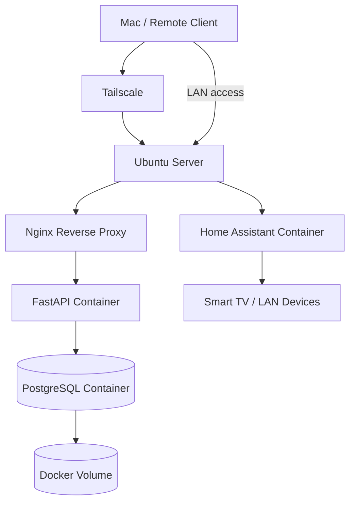

# Ubuntu Home Lab

A hands-on home lab built on an old ASUS laptop running Ubuntu Server.

The goal of this project is to learn Linux administration, networking, VPNs, Docker, web APIs, reverse proxies, databases, smart-home infrastructure, and eventually local AI/LLM workloads by building and operating a real self-hosted environment.

## Current Architecture



The FastAPI application is isolated behind Nginx and communicates with PostgreSQL over an internal Docker network. PostgreSQL data is stored persistently in a Docker volume. Home Assistant runs as a separate Compose project using host networking so that it can discover compatible devices on the local network.

---

## Project Evolution

### 1. Bare-metal Ubuntu Server

The project started by repurposing an old ASUS laptop as a dedicated home server.

Work completed:

- Installed Ubuntu Server on the physical laptop.
- Connected it to the home network over Ethernet.
- Configured a DHCP reservation on the home router so the server keeps a stable LAN IP.
- Configured the machine to continue running with the laptop lid closed.
- Used a Mac as the administration/client machine.

This created the physical foundation for everything that followed.

### 2. Remote Administration with SSH

SSH was configured and troubleshooted until reliable remote access to the Ubuntu server was restored.

The basic model became:

```text
Mac
  |
  | SSH
  v
Ubuntu Server
```

This removed the need to physically work on the laptop for normal administration.

### 3. Private Remote Access with Tailscale

Tailscale was installed on both the Ubuntu server and the Mac.

This added a private VPN-style network between the devices:

```text
Mac
  |
  | Tailscale
  v
Ubuntu Server
```

This allows remote SSH and access to self-hosted services without exposing SSH or application ports directly to the public Internet.

The project also introduced concepts such as:

- private vs public IP addresses
- routing
- VPN interfaces
- split tunneling
- optional exit-node routing
- remote access without traditional port forwarding

### 4. Docker Engine

Docker Engine was installed on Ubuntu Server.

The first test was:

```bash
docker run hello-world
```

This verified that Docker Engine could:

1. pull an image
2. create a container
3. start its main process
4. display its output
5. stop the container when the process exited

This introduced the distinction between an **image** and a **container**.

```text
Image
  |
  | docker run
  v
Container
```

An image is a packaged template. A container is an instance created from that image.

### 5. First Long-Running Container: Nginx

The next container was Nginx:

```bash
docker run --name my-nginx -p 8080:80 -d nginx
```

This introduced:

- long-running containers
- detached mode
- host-to-container port mapping
- container logs
- container lifecycle commands
- Docker networking

The important networking relationship was:

```text
Mac
  |
  | HTTP :8080
  v
Ubuntu Server
  |
  | Docker port mapping 8080 -> 80
  v
Nginx Container
```

Unlike `hello-world`, Nginx stayed running because its main process continued waiting for HTTP requests.

### 6. Inspecting Docker Networking

The Nginx experiment was also used to inspect what Docker creates underneath.

Topics explored included:

- `docker0`
- Docker bridge networking
- container IP addresses
- virtual Ethernet (`veth`) interfaces
- host vs container process views
- Linux namespaces
- port mappings
- packet inspection with tools such as `tcpdump`

This reinforced that a container is not a full virtual machine. Containers share the host's Linux kernel while receiving isolated views of processes, networking, filesystems, and other resources.

### 7. First Custom Application: FastAPI

A small Python FastAPI application was built with endpoints such as:

```text
GET /
GET /health
GET /server-info
```

It was first run directly on Ubuntu using Python and a virtual environment (`venv`).

The architecture at this stage was:

```text
Mac
  |
  | HTTP :8000
  v
Ubuntu Server
  |
  v
Uvicorn / FastAPI
```

This made it possible to understand the application before introducing Docker.

### 8. Containerizing the FastAPI Application

A `Dockerfile` was then created for the FastAPI application.

The workflow became:

```text
Python source code
       |
       v
Dockerfile
       |
       | docker build
       v
Docker Image
       |
       | docker run
       v
Docker Container
```

The custom image was built with:

```bash
docker build -t home-api:1.0 .
```

and then run as a container.

This was the first Docker image created specifically for this project rather than pulled directly from a public registry.

The `/server-info` endpoint demonstrated container isolation because the hostname reported from inside the application was the container hostname rather than the Ubuntu host hostname.

### 9. Moving from One Container to Multiple Containers

The API was then expanded so that it could persist notes in PostgreSQL.

Instead of putting the database in the same container, the application was split into two services:

```text
FastAPI Container
       |
       | PostgreSQL protocol :5432
       v
PostgreSQL Container
```

This introduced the idea that containers should normally have focused responsibilities.

The API container runs the application.

The PostgreSQL container runs the database.

### 10. Docker Compose

Managing several containers with separate `docker run` commands would quickly become difficult, so Docker Compose was introduced.

A `compose.yaml` was created to describe the application stack declaratively.

Compose became responsible for:

- building the API image
- starting the API container
- pulling and starting PostgreSQL
- creating the Docker network
- supplying environment variables
- starting services in the correct order
- attaching persistent storage

Instead of several manual commands, the stack could now be managed with:

```bash
docker compose up -d
docker compose down
docker compose ps
docker compose logs
```

### 11. Docker Service Discovery

Inside the Compose network, the FastAPI application connects to PostgreSQL using the service name:

```text
db
```

rather than a hard-coded container IP.

Conceptually:

```text
api
 |
 | DNS lookup: db
 v
Docker internal DNS
 |
 v
PostgreSQL container
```

This is important because container IP addresses are disposable and may change whenever containers are recreated.

### 12. Persistent Storage

A Docker named volume was added for PostgreSQL data.

```text
PostgreSQL Container
       |
       v
Docker Volume
```

The key experiment was:

1. create data through the API
2. run `docker compose down`
3. recreate the containers
4. query the API again
5. verify that the data still existed

This demonstrated an important infrastructure principle:

> Containers are disposable; important data should live outside the container lifecycle.

### 13. Nginx Reverse Proxy

Nginx was then added as another Compose service.

The architecture changed from:

```text
Mac -> FastAPI
```

to:

```text
Mac -> Nginx -> FastAPI -> PostgreSQL
```

FastAPI was no longer directly published on the Ubuntu host.

Only Nginx exposed a host port.

Nginx forwards incoming HTTP requests to the internal `api` service.

This introduced the reverse-proxy pattern that can later be used to route traffic to several self-hosted services.

### 14. Frontend and Backend Docker Networks

The Compose project was further divided into two Docker networks.

```text
             frontend
Nginx <----------------> FastAPI

                         FastAPI <----------------> PostgreSQL
                                     backend
```

The services were assigned as follows:

| Service | Frontend | Backend |
|---|---:|---:|
| Nginx | Yes | No |
| FastAPI | Yes | Yes |
| PostgreSQL | No | Yes |

This means:

- Nginx can reach FastAPI.
- FastAPI can reach PostgreSQL.
- Nginx cannot directly reach PostgreSQL.
- PostgreSQL is not exposed to the LAN.

This is a simple example of network segmentation.

### 15. Home Assistant

Home Assistant was deployed as a separate Docker Compose project.

Unlike the FastAPI stack, Home Assistant uses host networking:

```yaml
network_mode: host
```

This gives Home Assistant direct access to the Ubuntu host's network namespace, which is useful for discovering compatible smart-home devices and services on the LAN.

Home Assistant successfully discovered devices already present on the home network, including a smart TV.

The TV could be controlled from Home Assistant over the local IP network without enabling Bluetooth access for the container.

This introduced Home Assistant concepts such as:

```text
Integration
    |
    v
Device
    |
    v
Entity
    |
    v
State
    |
    v
Automation
```

The project is currently at the stage of learning Home Assistant automations and preparing to add additional smart-home devices and sensors.

---

## Repository Structure

A practical repository layout is:

```text
ubuntu-homelab/
├── README.md
├── .gitignore
├── .env.example
│
├── home-api/
│   ├── main.py
│   ├── requirements.txt
│   ├── Dockerfile
│   ├── compose.yaml
│   └── nginx/
│       └── default.conf
│
├── home-assistant/
│   ├── compose.yaml
│   └── README.md
│
└── docs/
    ├── architecture.md
    └── networking.md
```

Do **not** commit the real Home Assistant `/config` directory or any real `.env` file.

---

## Security / Files That Must Not Be Committed

The repository should never contain:

- `.env` files containing real credentials
- passwords
- API keys
- SSH private keys
- Tailscale authentication keys
- Home Assistant secrets
- Home Assistant `.storage/`
- personal device identifiers that should remain private
- persistent database data
- private certificates or private keys

Example `.gitignore`:

```gitignore
.env
.venv/
__pycache__/
*.pyc

# Home Assistant
home-assistant/config/

# Local data
*.db
*.sqlite

# Editor / OS files
.DS_Store
.vscode/
```

An `.env.example` file can be committed to document required variables without exposing real values.

Example:

```env
POSTGRES_USER=homelab
POSTGRES_PASSWORD=change-me
POSTGRES_DB=homelab
```

---

## Skills Practiced

This project has provided hands-on experience with:

- Ubuntu Server administration
- SSH
- Linux networking
- LAN addressing and DHCP reservations
- Tailscale / VPN networking
- Docker Engine
- Docker images and containers
- Dockerfiles
- Docker bridge networking
- Docker Compose
- container DNS/service discovery
- Docker volumes and persistence
- Nginx
- reverse proxies
- FastAPI
- REST APIs
- PostgreSQL
- frontend/backend network segmentation
- Home Assistant
- smart-home device discovery
- Home Assistant devices and entities
- Git/GitHub workflow and infrastructure documentation

---

## Next Steps

Planned additions include:

1. Create and document Home Assistant automations.
2. Add the Home Assistant mobile app and notifications.
3. Add physical smart-home sensors, starting with temperature/humidity.
4. Explore Zigbee, MQTT, and Wi-Fi smart-home protocols.
5. Add DNS/friendly service names.
6. Add HTTPS/TLS to self-hosted web services.
7. Add monitoring and backup strategies.
8. Deploy Ollama and experiment with local LLMs.
9. Build an API/service that communicates with the local LLM.
10. Expand the lab into a larger AI/RAG application.
11. Continue practicing Git with feature branches, meaningful commits, tags, and documentation.

---

## Why This Project Exists

This home lab is intentionally built as a learning environment rather than as a production system.

The main objective is not simply to make services work, but to understand what happens underneath them:

```text
Application
   |
Container
   |
Docker network
   |
Linux networking
   |
Ubuntu
   |
Physical hardware
```

Each new service is used as an opportunity to learn the operating-system, networking, deployment, security, and software-development concepts behind it.
